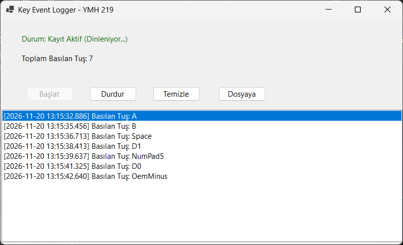
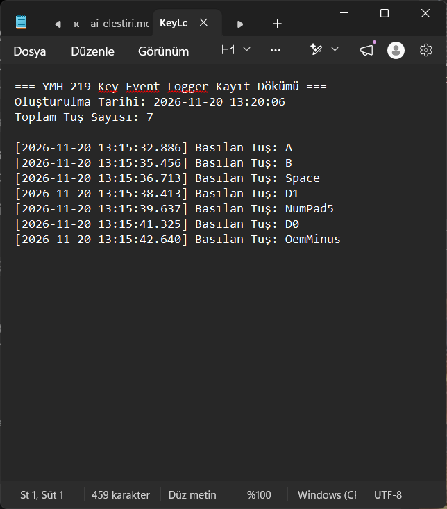

# YMH 219 - Key Event Logger Uygulaması

* **Öğrenci Adı Soyadı:** Hayrunnisa Ekinci
* **Öğrenci Numarası:** 240541043
* **Ders:** YMH 219 - Görsel Programlama / Nesne Yönelimli Programlama

## Proje Hakkında

Bu proje, C# Windows Forms (.NET 10.0) kullanılarak geliştirilmiş; uygulama penceresi odaktayken (in-app) gerçekleşen klavye tuş basımlarını (`KeyDown`) milisaniye hassasiyetinde zaman damgasıyla yakalayan, listeleyen ve metin dosyasına dışa aktarabilen nesne yönelimli bir **Olay Günlüğü (Key Event Logger)** uygulamasıdır.

## Kullanılan Teknoloji ve Kütüphaneler

* **Programlama Dili:** C#
* **Arayüz Çatısı:** Windows Forms (.NET 10.0)
* **Olay Yönetimi & Dosya İşlemleri:** `System.Windows.Forms` (`KeyPreview`, `KeyEventArgs`) ve `System.IO` (`StreamWriter`, `File`) — harici NuGet paketi gerektirmez.

## Uygulamanın Temel Özellikleri

* **Kontrollü Kayıt Yönetimi:** `Başlat` ve `Durdur` butonları ile klavye dinleme durumu güvenli bir şekilde yönetilir; aktif dinleme durumu kullanıcıya canlı durum etiketiyle bildirilir.
* **Milisaniye Hassasiyetli Zaman Damgalı Kayıt:** Basılan her tuş `[yyyy-MM-dd HH:mm:ss.fff]` biçiminde tarih/saat bilgisiyle listelenir ve `Toplam Basılan Tuş` sayacı anlık güncellenir.
* **Nesne Tabanlı Mimari (`KeyLogEntry` ve `KeyLoggerManager` Sınıfları):** Tuş olay modeli (`KeyLogEntry`) ile iş mantığı ve dosya yönetimi (`KeyLoggerManager`), arayüz katmanından (`Form1`) tamamen ayrılmıştır.
* **Dışa Aktarma & Temizleme:** Kaydedilen tuş geçmişi tek tuşla temizlenebilir veya `SaveFileDialog` aracılığıyla oluşturulma tarihi ve toplam tuş sayısı başlığıyla birlikte `.txt` formatında dışa aktarılabilir.

## Ekran Görüntüleri

### 1. Aktif Dinleme Durumu ve Zaman Damgalı Tuş Kayıt Görünümü

### 2. Dışa Aktarılan `.txt` Kayıt Dökümü Görünümü

## Bilinen Sınırlamalar ve Geliştirme Notları

* Uygulama etik ve güvenlik sınırları gereği yalnızca kendi penceresi aktif (odaklı) durumdayken klavye olaylarını yakalar; arka plan veya sistem geneli tuş dinleme (global hook) yapmaz.
* İlerleyen sürümlerde JSON formatında dışa aktarma ve oturum bazlı tuş sıklığı istatistik grafiği eklenebilir.

## Kurulum ve Çalıştırma Adımları

1. **Depoyu Bilgisayarınıza İndirin (Clone):**
   - Terminal veya PowerShell üzerinde `git clone https://github.com/eknchayru403-afk/YMH219-KeyEventLogger.git` komutunu çalıştırın.
   - Alternatif olarak GitHub sayfasında sağ üstteki **Code** -> **Download ZIP** seçeneğiyle projeyi arşiv olarak indirip klasöre çıkartın.

2. **Visual Studio ile Açın:**
   - İndirdiğiniz klasörün içindeki `YMH219-KeyEventLogger.csproj` (veya `.slnx`) dosyasına çift tıklayarak projeyi **Visual Studio 2026** (.NET 10.0) ile açın.

3. **Projeyi Derleyin:**
   - Bu proje yalnızca .NET 10.0 ile yerleşik gelen `System.Windows.Forms` ve `System.IO` kütüphanelerini kullandığından harici bir NuGet paketi kurulumu gerekmez.
   - Üst menüden **Derle -> Çözümü Derle** (`Ctrl + Shift + B`) seçeneğiyle projenin hatasız derlendiğini doğrulayın.

4. **Uygulamayı Başlatın:**
   - Üst araç çubuğundaki yeşil **Başlat** butonuna tıklayın veya klavyeden **`F5`** tuşuna basın; **`Başlat`** butonuna basıp klavyeden tuşlara basarak kayıtları test edin.
